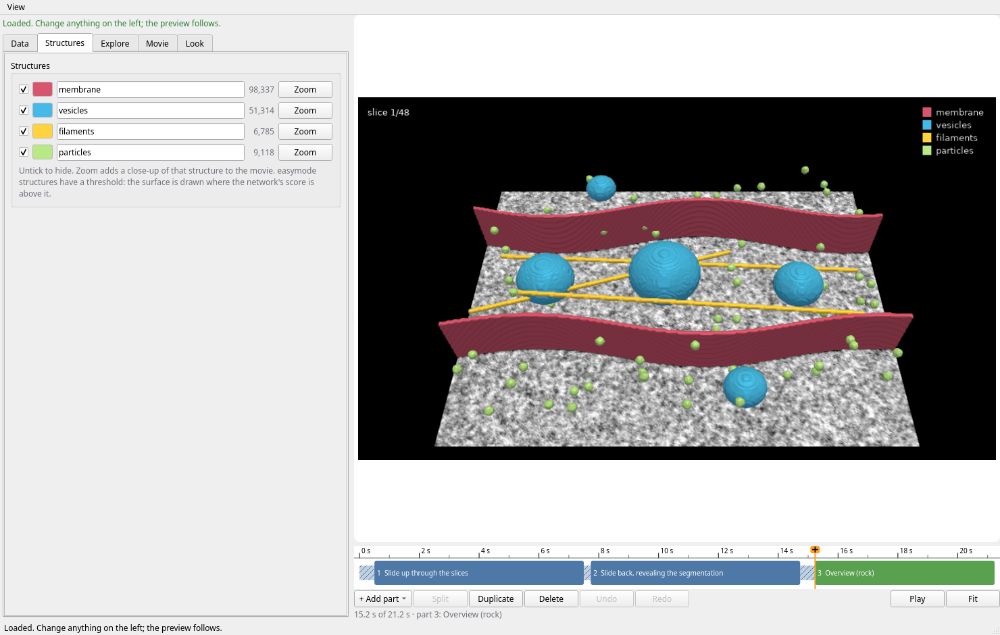
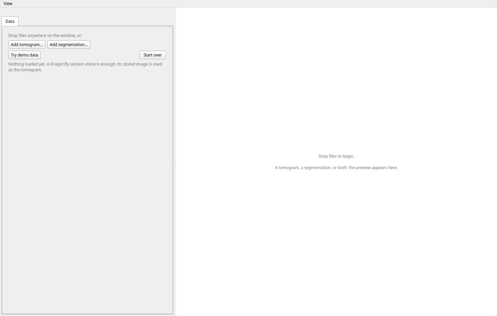
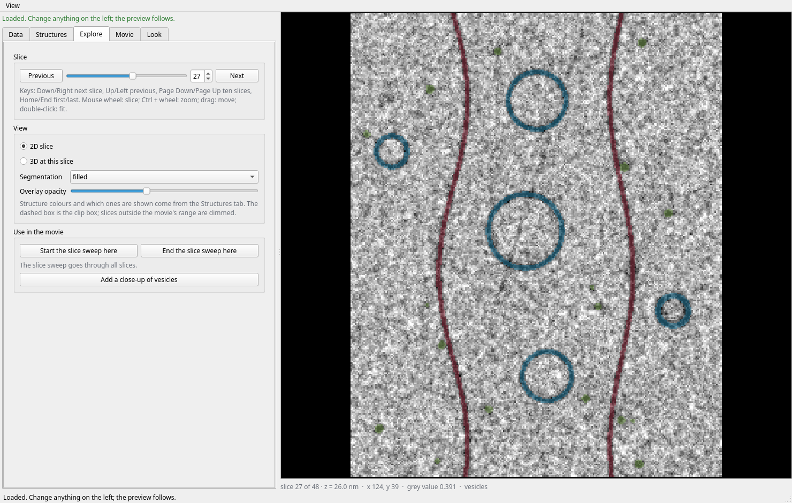
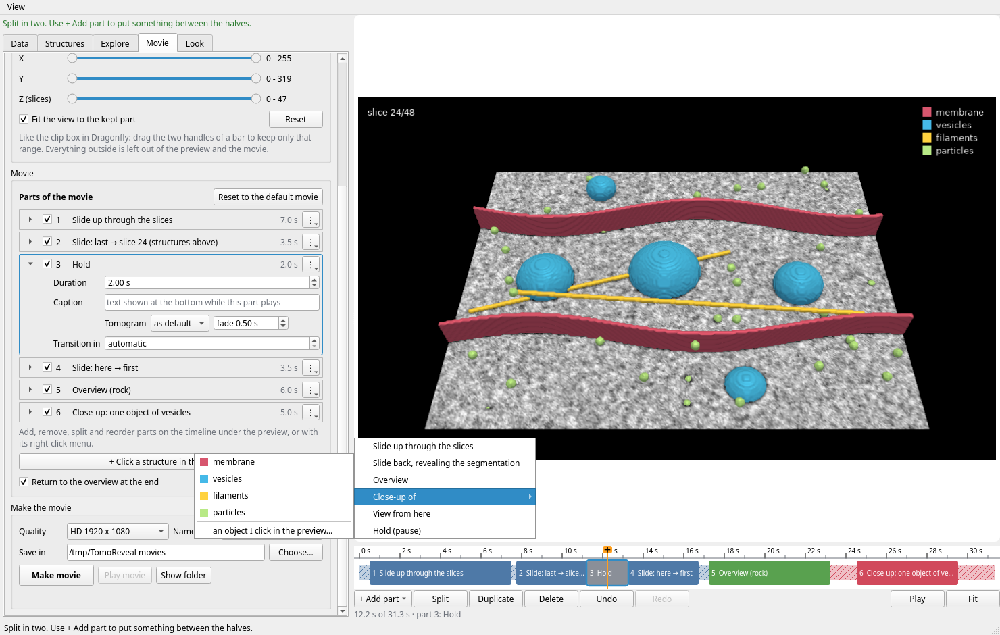
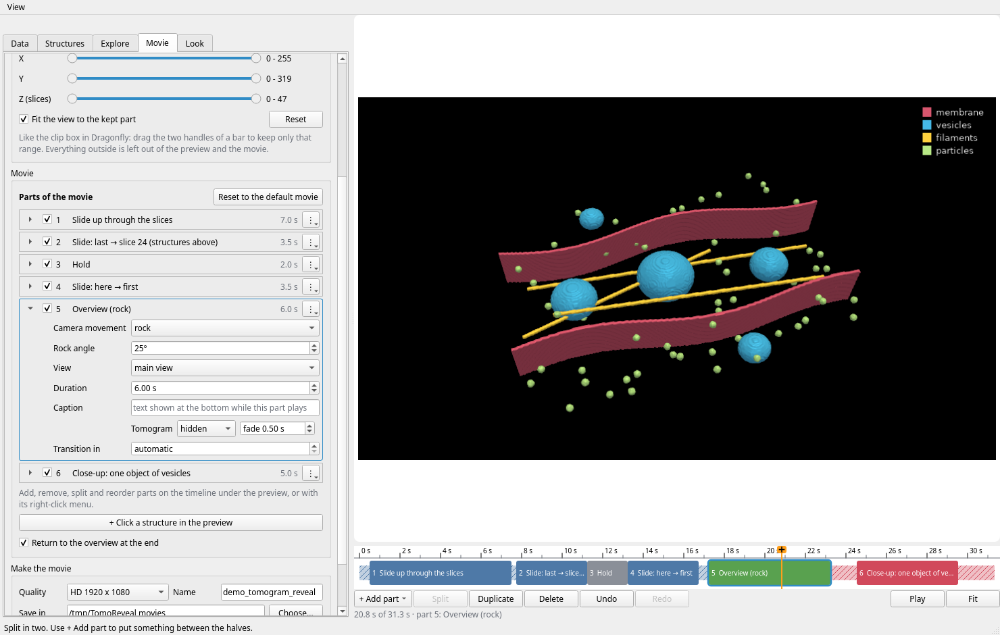
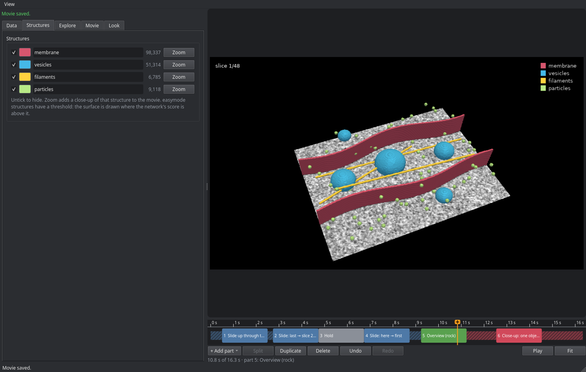

# TomoReveal

TomoReveal is a desktop application that makes movies from cryo-electron tomograms and their segmentations. A slice moves up through the tomogram. On the way back, the 3D segmentation appears above the slice. Then the camera can rock, spin, or fly to close-ups of the structures that you select.

TomoReveal reads these segmentations:

- Dragonfly sessions (`.ORSSession`). You do not have to export anything from Dragonfly.
- easymode and Ais output (one `name__feature.mrc` file for each structure).
- Label volumes from other programs (`.mrc` or `.tif` that contain whole numbers).

The application is read-only for your data. It does not edit, rename or move tomograms, sessions or segmentations. It writes only the movies, in the folder that you select. It runs on your computer and does not send data to the internet.

This is version 3.3.0. The [change log](CHANGELOG.md) lists the changes in each release.

## Supported platforms

| Operating system | Terminal to use | Status |
|---|---|---|
| Linux | Bash | Tested (installation, tests and the window, with software rendering) |
| Windows 10 or 11 | PowerShell, Miniforge Prompt or Anaconda Prompt | Not tested yet |
| macOS | Terminal with Zsh or Bash | Not tested yet |

Everything is installed into a separate Conda environment named `tomoreveal`. The Python of your system is left as it is.

## Before you start

You need:

- A 64-bit Linux, Windows or macOS computer with a graphical desktop. About 4 GB of free disk space.
- A Conda-compatible installer, for example [Miniforge](https://conda-forge.org/download/). See the [Conda installation instructions](https://docs.conda.io/projects/conda/en/stable/user-guide/install/).
- [Git](https://git-scm.com/downloads). This is not necessary if you download a ZIP archive.
- A tomogram and a segmentation of it. See [Supported files](#supported-files). To try the application first, use the built-in demo data.

Install Conda first if it is not on the computer, and then start a new terminal. This command shows whether Conda is ready:

~~~text
conda --version
~~~

If you do not want to install Conda, use the [installer scripts](#install-without-conda).

## Install and start the application

### Windows PowerShell

In PowerShell, run these commands. Put the address of the repository in the first line.

~~~powershell
git clone PASTE_REPOSITORY_URL_HERE
Set-Location TomoReveal
conda env create -f environment.yml
conda activate tomoreveal
python -m pip install --no-deps -e .
tomoreveal
~~~

### Linux or macOS

In a terminal, run these commands. Put the address of the repository in the first line.

~~~bash
git clone PASTE_REPOSITORY_URL_HERE
cd TomoReveal
conda env create -f environment.yml
conda activate tomoreveal
python -m pip install --no-deps -e .
tomoreveal
~~~

No Git? Download the ZIP archive of the repository and unpack it. Open a terminal in the unpacked folder (the one with `environment.yml` in it) and skip the `git clone` line and the line after it.

The `conda env create` command downloads Python, Qt and the 3D and video libraries. This takes some minutes. FFmpeg for the movie files is included; a separate installation is not necessary.

### Linux: add software rendering

On Linux, also install the Mesa software renderer. TomoReveal uses it when the graphics driver cannot be used, and on computers without a display:

~~~bash
conda install -n tomoreveal -c conda-forge mesalib
~~~

Do not install this package on Windows. There it replaces the graphics driver with slow software rendering for the whole environment.

If `tomoreveal` is not found, this does the same:

~~~text
python -m tomoreveal
~~~

To start the application on a later day, open a terminal and run:

~~~text
conda activate tomoreveal
tomoreveal
~~~

### Install without Conda

The `installers` folder contains scripts that download a small package manager (micromamba), install everything in one folder of your user account, and make a shortcut. Administrator rights are not necessary.

| Operating system | What to do | Result |
|---|---|---|
| Linux | Run `bash installers/install_tomoreveal.sh` in the TomoReveal folder | TomoReveal in the applications menu |
| macOS | Run `bash installers/install_tomoreveal.sh` in the TomoReveal folder | `TomoReveal.command` on the Desktop |
| Windows | Double-click `installers\install_tomoreveal.bat` | TomoReveal on the desktop and in the Start menu |

The Linux script is tested. The macOS and Windows scripts are not tested yet.

### Make sure that the installation is correct

Start the application and click **Try demo data**. Or run this command:

~~~text
tomoreveal demo
~~~

The application writes a small made-up tomogram in a temporary folder and opens it. If you see the tomogram slice with coloured membranes, vesicles, filaments and particles, the installation is correct.

## Make a movie

### 1. Load the files

Drop the files on the window, or use the buttons in the **Data** tab. You can drop all files at the same time, and add more later: new files are added to what is loaded. **Start over** unloads everything.

| You have | Drop these files |
|---|---|
| A Dragonfly session | The `.ORSSession` file. The tomogram file is optional, because the session contains a copy of the image. |
| easymode or Ais output | The tomogram and the `name__feature.mrc` files |
| A label volume | The tomogram and the label file |
| Only a tomogram | The tomogram. The movie is the slice sweep and the overview. |
| Only a segmentation | The segmentation. The movie shows the structures without a tomogram. |
| A Dragonfly session and easymode output | All of them. The structures of both are shown. |

TomoReveal recognises each dropped file by its content. To choose yourself, use **Add tomogram...** (the file is always used as the tomogram) or **Add segmentation...** (a session, a label volume or easymode files; never used as the tomogram). If a dropped file was recognised wrongly, right-click it in the Data tab and choose **Use as tomogram** or **Use as segmentation**.

Large tomograms and sessions can take a minute to load. A line in the Data tab shows the progress.

### 2. Choose the tomogram and the segmentations

**TOMOGRAM** lists every image that you can show under the segmentation. Only one is used at a time:

- **None**: no tomogram. The structures are drawn on their own.
- **your file**: a tomogram file that you loaded.
- **from Dragonfly session ...**: each image that is saved in a session, also filtered copies that you made in Dragonfly. When you load only a session, its first image is selected for you.

Sometimes the image is changed during the import into Dragonfly: it is cropped, binned, or an axis is flipped. Then the tomogram file and the segmentation are not on the same grid. TomoReveal compares your file with Dragonfly's copy and finds the crop, the binning and the flips. It then puts your file on the grid of the segmentation. A line below the list tells you what it found, for example "cropped to x 60-767, y 150-1315, z 6-73". easymode files that were made from the original tomogram file are put on the Dragonfly grid in the same way. If the file is not the image that was imported, TomoReveal tells you and shows Dragonfly's copy.

**SEGMENTATION** lists every multi-ROI and ROI of each session, and each label or easymode file, with a tick box. Next to each one you see how many structures it has and, in grey, their names, so that you can see what you switch on. You can switch on several at the same time; their structures are listed in groups in the Structures tab. For each session, TomoReveal switches on the one that looks like the final segmentation. Change it with one click if it chose wrongly.

- A segmentation on another grid than the tomogram is greyed out, with the reason, for example "511 × 720 × 250 voxels, but the tomogram is 512 × 720 × 250".
- The single-slice previews that Dragonfly's Segmentation Wizard leaves in a session, and Dragonfly's undo copies, are not listed. A grey line says how many were left out.
- **Remove** unloads a file or a session. Your files on disk are not touched.

### 3. Set the structures

The **Structures** tab lists the structures with the names and colours that are saved in the Dragonfly session (or in the `.json` file next to a label volume). For each structure you can:

- remove the tick to hide it.
- click the coloured box to change the colour.
- change the name. The legend uses this name.
- move the **threshold** bar (easymode and Ais structures only). The surface is drawn where the score of the network is above the threshold.

Structures that are hidden in Dragonfly, and the background, are listed in grey with the tick removed. Tick them to show them anyway. A structure that has no name in the session is shown as "label 3 (no name in the session)".

### Look through the slices

The **Explore** tab is for looking at the data slice by slice. It does not change the movie.

- Move through the slices with the slider, **Previous** and **Next**, the mouse wheel, or the keys: Down or Right for the next slice, Up or Left for the previous one, Page Down and Page Up for ten slices, Home and End for the first and the last slice.
- **2D slice** shows the slice flat, with the segmentation filled, as outlines, or off. **Overlay opacity** sets how strongly the colours cover the slice. Ctrl + mouse wheel zooms, dragging moves the image, and a double-click shows the whole slice again.
- **3D at this slice** shows the 3D view with the slice at this position, and the structures above the slice, all structures, or none.
- The line below the image shows the slice number, the depth in nm, and under the mouse the position, the grey value and the name of the structure.
- Colours and which structures are shown come from the Structures tab. The clip box is drawn as a dashed rectangle, and slices outside the movie's slice range are dimmed.

Three buttons pass what you found to the movie: **Start the slice sweep here**, **End the slice sweep here**, and **Add a close-up of** the structure under the mouse.

### 4. Set the view

In the **Movie** tab, set the **main view**: click a view button, or use the **Tilt**, **Rotate** and **Zoom** bars. You can also drag in the preview to rotate, and scroll to zoom.

### 5. Clip the tomogram

Use **Clip** to keep only a part of the tomogram, as with the clip box in Dragonfly. Each bar has two handles. Drag them to set the range that you keep along X, Y and Z. The parts outside the range are not shown in the preview or in the movie. The slice moves only through the Z range that you keep.

**Fit the view to the kept part** moves the camera closer. Remove the tick to keep the camera where it is. **Reset** shows the full tomogram again.

### 6. Build the movie on the timeline

The strip under the preview is the **timeline**. Each part of the movie is a coloured block, in the order in which it plays; its width is its duration. Hatched stretches are the automatic camera flights and pauses between parts. The orange line is the **playhead**: the preview shows the frame under it.

The default movie has three parts: **Slide up through the slices**, **Slide back, revealing the segmentation**, and **Overview**. You can change all of it:

- **Add a part** with **+ Add part** under the timeline, or with the small **+** on the playhead. The new part goes directly after the part under the playhead. Choose from: Slide up through the slices, Slide back revealing the segmentation, Overview, View from here, **Close-up of** a structure (or of "an object I click in the preview"), and Hold (a pause).
- **Remove a part** with **Delete** (or the Delete key). Any part can be removed, also the default ones. **Undo** brings it back. **Reset to the default movie** (Movie tab) starts again from the three default parts.
- **Make a part longer or shorter**: drag the right edge of its block.
- **Move a part**: drag its block to another place.
- **Split** cuts a slide or a hold in two at the playhead. Then **+ Add part** puts something between the halves, for example a hold to stop the slice in the middle, or a close-up.
- Untick a part in the Movie tab to leave it out without removing it.
- Right-click a block for the same actions.

| On the timeline | Does |
|---|---|
| Click or drag on the time scale | Moves the playhead; the preview follows |
| Click a block | Selects the part and opens its settings in the Movie tab |
| Double-click a block | Opens its settings and shows the Movie tab |
| Drag the right edge of a block | Changes its duration (0.1 s steps; with Shift 0.5 s) |
| Drag a block sideways | Moves it; Esc cancels |
| Right-click a block | Add part after, Duplicate, Split here, Move left, Move right, Switch off, Delete |
| Ctrl + mouse wheel | Zooms in time; **Fit** shows the whole movie again |
| Left / Right arrow | One frame back / forward (with Shift: one second) |
| Up / Down arrow | Previous / next part |
| Home / End | Start / end of the movie |
| Space | Play / stop |
| Delete | Removes the selected part |
| Ctrl+D | Duplicates it |
| S | Splits the part under the playhead |
| Ctrl+Z, Ctrl+Shift+Z (or Ctrl+Y) | Undo, redo |

The keys work while the timeline has the focus (click on it first), so they never change the movie while you type a caption.

**Play** plays the movie in the preview from the playhead, in real time. When drawing is slow (large tomograms, software rendering), it skips frames to keep time; the movie file always has every frame.

#### The parts in the Movie tab

The **Movie** tab lists the same parts, one line each. Click a line to open its settings; the other lines close, and the part is selected on the timeline. Every part has a **Duration**, a **Caption** (text at the bottom while it plays), a **Tomogram** choice (see the next step) and **Transition in** (the seconds of camera flight into it; **automatic**, or 0 to cut straight to it).

| Part | Settings |
|---|---|
| Slide | From (first slice, last slice, where the slice is, a slice number), To, Structures (hidden, above the slice, all, leave as they are), Pause before, Pause after |
| Overview | Camera movement (rock, full spin, still), Rock angle, View (main view or own view) |
| Close-up | Structure (a list of the loaded structures with their colours), Object (whole structure, the object you picked, or "pick an object in the preview..."), Other structures (grey, hidden, unchanged), Camera movement (orbit, rock, still), Zoom, Tilt |
| Hold | only the common settings |

#### Close-ups

- Click **Zoom** next to a structure in the Structures tab, or use **+ Add part > Close-up of**, to add a close-up of all of that structure.
- Click **+ Click a structure in the preview** (or choose "an object I click in the preview"), then click one object (one vesicle, one filament) to add a close-up of that object only.
- To change what a close-up shows, open it and choose another **Structure** or **Object** from the lists. The caption follows the structure unless you typed your own.
- A close-up of a structure that you switched off in the Data tab stays in the list, marked "structure not loaded", and is left out of the movie until the structure is back.

#### View from here

**+ Add part > View from here** adds a still view with its own camera position, taken from the main view. While that part is selected and the playhead is inside it, dragging and scrolling in the preview change the view of this part only (the preview says "Changing the view of part 4"); its line in the Movie tab also has Tilt, Rotate and Zoom bars. Two of these parts in a row make the camera fly from one position to the other.

### 7. Show, fade or hide the tomogram

In the **Look** tab, **Tomogram slice** sets the default for the whole movie: **Show the tomogram slice**, and its **Opacity** from 0 to 100 %.

In the **Movie** tab, each part of the movie has its own **Tomogram** choice:

- **as default**: as set in the Look tab.
- **shown**: fully visible.
- **faded**: see-through, with the opacity that you set for this part.
- **hidden**: not shown, so only the structures are visible.

The change happens at the start of the part, over the **fade** time (0.5 s unless you change it). For example, set the overview to **hidden** to let the tomogram fade out after the reveal. If you hide the tomogram during a slide up, a grey line warns you that this part then shows nothing.

### 8. Make the movie

At the end of the **Movie** tab, select the quality, the name and the folder. Click **Make movie**. The movie is exactly what the timeline shows. A bar shows the progress and the time that remains. When the movie is complete, click **Play movie** to open it in your video player, or **Show folder**.

Save the movies in a folder that is not your data folder.

## Dark mode

In the **View** menu, or in the Look tab under **Window**, choose the theme: **System** (follow the desktop), **Light** or **Dark**. TomoReveal remembers the choice. The theme changes only the window; the background of the movie is set separately in the Look tab.

## Supported files

| Type | Files | Notes |
|---|---|---|
| Tomogram | `.mrc` `.rec` `.map` `.mrcs` `.st` `.tif` `.tiff` | |
| Dragonfly session | `.ORSSession` | Multi-ROIs, ROIs and the saved images |
| Label volume | `.mrc` `.tif` with whole numbers | One number for each structure. Put a `.json` file with the same name next to it to give names and colours: `{"1": {"name": "membrane", "color": "#d7566e"}}` |
| easymode or Ais output | `name__feature.mrc` | One file for each structure. Scores as int8 (0 to 127), uint16 (0 to 255) or float32 (0 to 1). |

The tomogram and the segmentation must show the same volume, and so must several segmentations that are switched on together. A segmentation at a different binning of the same volume is resampled. For Dragonfly sessions, see [Choose the tomogram and the segmentations](#2-choose-the-tomogram-and-the-segmentations).

These files are not supported: Dragonfly `.ORSObject` files, Amira `.am`, IMOD `.mod`, and particle coordinate files such as `.star`.

## Update an installation

In a terminal in the TomoReveal folder, run:

~~~text
git pull
conda env update -n tomoreveal -f environment.yml --prune
conda activate tomoreveal
python -m pip install --no-deps -e .
~~~

Without Git, download and unpack the new ZIP archive, and run the last three commands in that folder.

If you used an installer script, run the installer script of the new version again.

On Linux, `--prune` removes the software renderer. Run the command in [Linux: add software rendering](#linux-add-software-rendering) again after an update.

## Troubleshooting

### conda is not recognised

A terminal that was open before Conda was installed does not know about it: start a new one. On Windows, the Miniforge Prompt or Anaconda Prompt always works. On Linux or macOS, this command sets up your shell; start a new terminal after it:

~~~text
conda init
~~~

### The environment already exists

You installed it before. Bring it up to date:

~~~text
conda env update -n tomoreveal -f environment.yml --prune
conda activate tomoreveal
python -m pip install --no-deps -e .
~~~

### tomoreveal is not recognised

The environment is probably not active. From the TomoReveal folder:

~~~text
conda activate tomoreveal
python -m pip install --no-deps -e .
python -m tomoreveal
~~~

### The preview is black, or the application reports a graphics problem

On Linux, the application then changes to software rendering, which is slower but does not use the graphics driver. This needs the package from [Linux: add software rendering](#linux-add-software-rendering). To start with software rendering, run:

~~~text
tomoreveal --headless
~~~

On Windows and macOS, update the graphics driver or the operating system.

### The structure names are not the ones in Dragonfly

Check which segmentation is ticked in the Data tab: a session can hold several, for example training data and the final result. To see exactly what TomoReveal reads from a session, run:

~~~text
tomoreveal inspect session.ORSSession
~~~

It prints each image and segmentation in the session, the stored names, colours and visible flags, and which stored property each was read from. Compare it with Dragonfly's Data Properties panel. Give a folder instead of a file to inspect every session in it, and add `--json` for output that other programs can read.

### A segmentation is greyed out, or "grid mismatch"

The tomogram and the segmentation do not show the same volume. Make sure that you selected the tomogram that the segmentation was made from. For a Dragonfly session, load the session without a tomogram file to use Dragonfly's copy of the image.

### A Dragonfly session cannot be read

The `.ORSSession` format is not documented. The reader was made from sessions that Dragonfly 2022.2 saved. For each multi-ROI, the reader compares its result with the voxel count that Dragonfly saved, and stops if they are different. If your session cannot be read, export the multi-ROI from Dragonfly as a TIFF stack and load it as a label volume.

### Linux shows a Qt platform-plugin error

The window needs a desktop. It cannot open over an SSH connection that has no display. To make movies on such a computer, see [Use without the window](#use-without-the-window).

## Use without the window

The same functions are available as commands, for example on a computer without a display:

~~~text
tomoreveal list    session.ORSSession
tomoreveal inspect session.ORSSession
tomoreveal movie   tomogram.mrc --session session.ORSSession --view oblique,top --focus "vesicles" -o movie.mp4
tomoreveal movie   tomogram.mrc --features tomogram__membrane.mrc --threshold 0.5 --clip 0,400,0,600,10,50
tomoreveal extract session.ORSSession --masks -o segmentation_out
tomoreveal --help
~~~

On a Linux computer without a display, add `--headless` to the `movie` command.

`tomoreveal extract` writes the selected Dragonfly segmentation as `labels.mrc` with the names and colours in `classes.json`.

`tomoreveal inspect` prints what TomoReveal reads from a session; see [The structure names are not the ones in Dragonfly](#the-structure-names-are-not-the-ones-in-dragonfly).

`tomoreveal app` shows the controls in a web browser tab on this computer in place of the window. This older interface does not have the clip bars, the Explore tab, the tomogram controls or dark mode.

## Scope and data safety

- Use this application to make movies of tomograms with segmentations. It does not make or edit segmentations.
- The application does not write to your tomograms, sessions or segmentation files.
- The application does not connect to the internet. The installation downloads the libraries one time.
- The screenshots in this document show made-up demo data.
- The surfaces in the movie are smoothed for display. Do not use the movie for measurements.

## Developer use

The source code is in the `tomoreveal` folder:

| File | Contents |
|---|---|
| `dragonfly.py` | Reader for `.ORSSession` files |
| `volumes.py` | Reading volumes, recognising file types, surfaces |
| `matching.py` | Lining up a tomogram file with Dragonfly's copy |
| `storyboard.py` | Camera, clip box, the parts of the movie, editing them, undo, and the frame-by-frame plan |
| `render.py` | Drawing one frame and writing the movie |
| `studio.py` | Program state that the window and the commands share |
| `gui.py` | The desktop window |
| `gui_data.py` | The Data tab |
| `gui_explore.py`, `explore.py` | The Explore tab and its slice drawing |
| `gui_theme.py` | Light and dark themes |
| `gui_timeline.py` | The timeline under the preview |
| `gui_movie.py` | Editing the movie (add, delete, split, undo) and the parts list of the Movie tab |
| `cli.py`, `webapp.py`, `demo.py` | Commands, browser interface, demo data |

To run the tests:

~~~text
conda activate tomoreveal
python -m pytest
~~~

The tests use made-up data, including small made-up Dragonfly sessions. To also test real sessions, set `TOMOREVEAL_TEST_DATA` to a folder that contains them (outside the repository); those tests are skipped otherwise. The tests that draw are skipped on a computer where no renderer can start.

## License

TomoReveal is released under the [MIT License](LICENSE).
