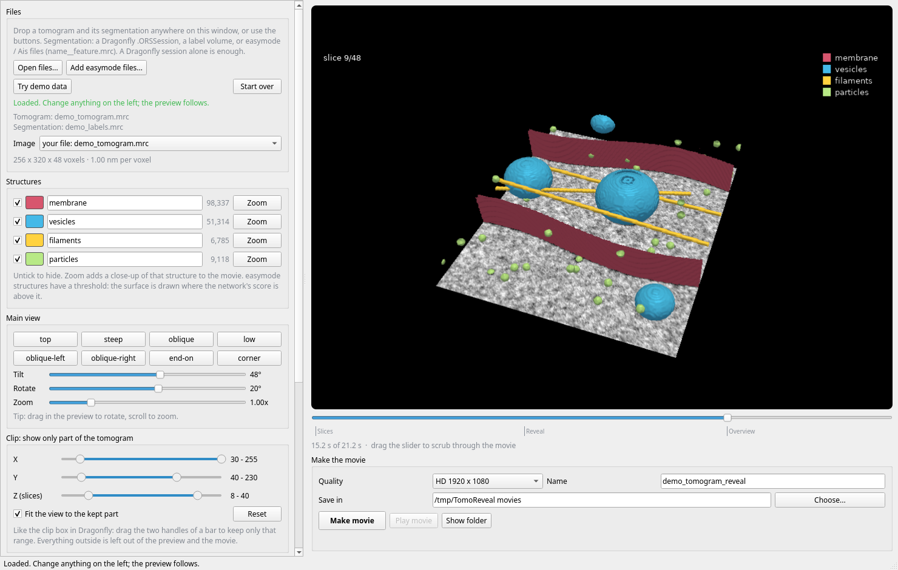
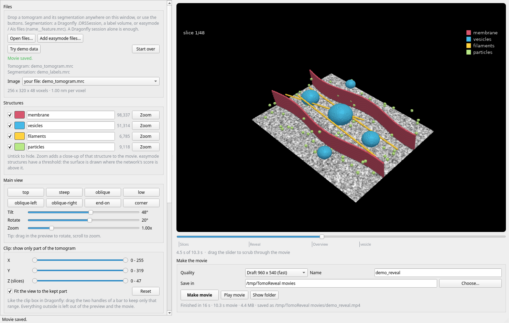

# TomoReveal

TomoReveal is a desktop application that makes movies from cryo-electron tomograms and their segmentations. A slice moves up through the tomogram. On the way back, the 3D segmentation appears above the slice. Then the camera can rock, spin, or fly to close-ups of the structures that you select.

TomoReveal reads these segmentations:

- Dragonfly sessions (`.ORSSession`). You do not have to export anything from Dragonfly.
- easymode and Ais output (one `name__feature.mrc` file for each structure).
- Label volumes from other programs (`.mrc` or `.tif` that contain whole numbers).

The application is read-only for your data. It does not edit, rename or move tomograms, sessions or segmentations. It writes only the movies, in the folder that you select. It runs on your computer and does not send data to the internet.

This is version 3.1.0. The [change log](CHANGELOG.md) lists the changes in each release.

## Supported platforms

| Operating system | Terminal to use | Status |
|---|---|---|
| Linux | Bash | Tested (installation, tests and the window, with software rendering) |
| Windows 10 or 11 | PowerShell, Miniforge Prompt or Anaconda Prompt | Not tested yet |
| macOS | Terminal with Zsh or Bash | Not tested yet |

Everything is installed into a separate Conda environment named `tomoreveal`. The Python of your system is left as it is.

## Before you start

You need:

- A 64-bit Linux, Windows or macOS computer with a graphical desktop. About 4 GB of free disk space.
- A Conda-compatible installer, for example [Miniforge](https://conda-forge.org/download/). See the [Conda installation instructions](https://docs.conda.io/projects/conda/en/stable/user-guide/install/).
- [Git](https://git-scm.com/downloads). This is not necessary if you download a ZIP archive.
- A tomogram and a segmentation of it. See [Supported files](#supported-files). To try the application first, use the built-in demo data.

Install Conda first if it is not on the computer, and then start a new terminal. This command shows whether Conda is ready:

~~~text
conda --version
~~~

If you do not want to install Conda, use the [installer scripts](#install-without-conda).

## Install and start the application

### Windows PowerShell

In PowerShell, run these commands. Put the address of the repository in the first line.

~~~powershell
git clone PASTE_REPOSITORY_URL_HERE
Set-Location TomoReveal
conda env create -f environment.yml
conda activate tomoreveal
python -m pip install --no-deps -e .
tomoreveal
~~~

### Linux or macOS

In a terminal, run these commands. Put the address of the repository in the first line.

~~~bash
git clone PASTE_REPOSITORY_URL_HERE
cd TomoReveal
conda env create -f environment.yml
conda activate tomoreveal
python -m pip install --no-deps -e .
tomoreveal
~~~

No Git? Download the ZIP archive of the repository and unpack it. Open a terminal in the unpacked folder (the one with `environment.yml` in it) and skip the `git clone` line and the line after it.

The `conda env create` command downloads Python, Qt and the 3D and video libraries. This takes some minutes. FFmpeg for the movie files is included; a separate installation is not necessary.

### Linux: add software rendering

On Linux, also install the Mesa software renderer. TomoReveal uses it when the graphics driver cannot be used, and on computers without a display:

~~~bash
conda install -n tomoreveal -c conda-forge mesalib
~~~

Do not install this package on Windows. There it replaces the graphics driver with slow software rendering for the whole environment.

If `tomoreveal` is not found, this does the same:

~~~text
python -m tomoreveal
~~~

To start the application on a later day, open a terminal and run:

~~~text
conda activate tomoreveal
tomoreveal
~~~

### Install without Conda

The `installers` folder contains scripts that download a small package manager (micromamba), install everything in one folder of your user account, and make a shortcut. Administrator rights are not necessary.

| Operating system | What to do | Result |
|---|---|---|
| Linux | Run `bash installers/install_tomoreveal.sh` in the TomoReveal folder | TomoReveal in the applications menu |
| macOS | Run `bash installers/install_tomoreveal.sh` in the TomoReveal folder | `TomoReveal.command` on the Desktop |
| Windows | Double-click `installers\install_tomoreveal.bat` | TomoReveal on the desktop and in the Start menu |

The Linux script is tested. The macOS and Windows scripts are not tested yet.

### Make sure that the installation is correct

Start the application and click **Try demo data**. Or run this command:

~~~text
tomoreveal demo
~~~

The application writes a small made-up tomogram in a temporary folder and opens it. If you see the tomogram slice with coloured membranes, vesicles, filaments and particles, the installation is correct.

## Make a movie

### 1. Load the files

Drop the files on the window, or click **Open files**. You can drop all files at the same time.

| You have | Drop these files |
|---|---|
| A Dragonfly session | The `.ORSSession` file. The tomogram file is optional, because the session contains a copy of the image. |
| easymode or Ais output | The tomogram and the `name__feature.mrc` files |
| A label volume | The tomogram and the label file |
| A Dragonfly session and easymode output | All of them. The structures of both are shown. |

Large tomograms and sessions can take a minute to load.

### 2. Select the image and the segmentation

When you load a Dragonfly session, the **Image** list contains:

- **your file**: the tomogram file that you loaded.
- **Dragonfly's copy**: each image that is saved in the session, also filtered copies that you made in Dragonfly.

Sometimes the image is changed during the import into Dragonfly: it is cropped, binned, or an axis is flipped. Then the tomogram file and the segmentation are not on the same grid. TomoReveal compares your file with Dragonfly's copy and finds the crop, the binning and the flips. It then puts your file on the grid of the segmentation. A line below the lists tells you what it found, for example "cropped to x 60-767, y 150-1315, z 6-73".

easymode files that were made from the original tomogram file are put on the Dragonfly grid in the same way.

If the file is not the image that was imported, TomoReveal tells you and shows Dragonfly's copy.

The **Segmentation** list contains each multi-ROI and ROI of the session. TomoReveal selects the one that looks like the final segmentation. Select a different one if necessary.

### 3. Set the structures

For each structure you can:

- remove the tick to hide it.
- click the coloured box to change the colour.
- change the name. The legend uses this name.
- move the **threshold** bar (easymode and Ais structures only). The surface is drawn where the score of the network is above the threshold.

### 4. Set the view

Click a view button, or use the **Tilt**, **Rotate** and **Zoom** bars. You can also drag in the preview to rotate, and scroll to zoom.

### 5. Clip the tomogram

Use **Clip** to keep only a part of the tomogram, as with the clip box in Dragonfly. Each bar has two handles. Drag them to set the range that you keep along X, Y and Z. The parts outside the range are not shown in the preview or in the movie. The slice moves only through the Z range that you keep.

**Fit the view to the kept part** moves the camera closer. Remove the tick to keep the camera where it is. **Reset** shows the full tomogram again.

### 6. Add close-ups

- Click **Zoom** next to a structure to add a close-up of all of that structure.
- Click **+ Click a structure in the preview**, then click one object (one vesicle, one filament) to add a close-up of that object only.

For each close-up you can set a caption, the duration, the zoom, the camera movement (orbit, rock or still), and what happens to the other structures (grey, hidden or unchanged).

Drag the bar below the preview to look through the full movie before you make it.

### 7. Make the movie

Select the quality, the name and the folder. Click **Make movie**. A bar shows the progress and the time that remains. When the movie is complete, click **Play movie** to open it in your video player, or **Show folder**.

Save the movies in a folder that is not your data folder.

## Supported files

| Type | Files | Notes |
|---|---|---|
| Tomogram | `.mrc` `.rec` `.map` `.mrcs` `.st` `.tif` `.tiff` | |
| Dragonfly session | `.ORSSession` | Multi-ROIs, ROIs and the saved images |
| Label volume | `.mrc` `.tif` with whole numbers | One number for each structure. Put a `.json` file with the same name next to it to give names and colours: `{"1": {"name": "membrane", "color": "#d7566e"}}` |
| easymode or Ais output | `name__feature.mrc` | One file for each structure. Scores as int8 (0 to 127), uint16 (0 to 255) or float32 (0 to 1). |

The tomogram and the segmentation must show the same volume. A segmentation at a different binning of the same volume is resampled. For Dragonfly sessions, see [Select the image and the segmentation](#2-select-the-image-and-the-segmentation).

These files are not supported: Dragonfly `.ORSObject` files, Amira `.am`, IMOD `.mod`, and particle coordinate files such as `.star`.

## Update an installation

In a terminal in the TomoReveal folder, run:

~~~text
git pull
conda env update -n tomoreveal -f environment.yml --prune
conda activate tomoreveal
python -m pip install --no-deps -e .
~~~

Without Git, download and unpack the new ZIP archive, and run the last three commands in that folder.

If you used an installer script, run the installer script of the new version again.

On Linux, `--prune` removes the software renderer. Run the command in [Linux: add software rendering](#linux-add-software-rendering) again after an update.

## Troubleshooting

### conda is not recognised

A terminal that was open before Conda was installed does not know about it: start a new one. On Windows, the Miniforge Prompt or Anaconda Prompt always works. On Linux or macOS, this command sets up your shell; start a new terminal after it:

~~~text
conda init
~~~

### The environment already exists

You installed it before. Bring it up to date:

~~~text
conda env update -n tomoreveal -f environment.yml --prune
conda activate tomoreveal
python -m pip install --no-deps -e .
~~~

### tomoreveal is not recognised

The environment is probably not active. From the TomoReveal folder:

~~~text
conda activate tomoreveal
python -m pip install --no-deps -e .
python -m tomoreveal
~~~

### The preview is black, or the application reports a graphics problem

On Linux, the application then changes to software rendering, which is slower but does not use the graphics driver. This needs the package from [Linux: add software rendering](#linux-add-software-rendering). To start with software rendering, run:

~~~text
tomoreveal --headless
~~~

On Windows and macOS, update the graphics driver or the operating system.

### The tomogram and the segmentation do not agree ("grid mismatch")

The two files do not show the same volume. Make sure that you selected the tomogram that the segmentation was made from. For a Dragonfly session, load the session without a tomogram file to use Dragonfly's copy of the image.

### A Dragonfly session cannot be read

The `.ORSSession` format is not documented. The reader was made from sessions that Dragonfly 2022.2 saved. For each multi-ROI, the reader compares its result with the voxel count that Dragonfly saved, and stops if they are different. If your session cannot be read, export the multi-ROI from Dragonfly as a TIFF stack and load it as a label volume.

### Linux shows a Qt platform-plugin error

The window needs a desktop. It cannot open over an SSH connection that has no display. To make movies on such a computer, see [Use without the window](#use-without-the-window).

## Use without the window

The same functions are available as commands, for example on a computer without a display:

~~~text
tomoreveal list    session.ORSSession
tomoreveal movie   tomogram.mrc --session session.ORSSession --view oblique,top --focus "vesicles" -o movie.mp4
tomoreveal movie   tomogram.mrc --features tomogram__membrane.mrc --threshold 0.5 --clip 0,400,0,600,10,50
tomoreveal extract session.ORSSession --masks -o segmentation_out
tomoreveal --help
~~~

On a Linux computer without a display, add `--headless` to the `movie` command.

`tomoreveal extract` writes the selected Dragonfly segmentation as `labels.mrc` with the names and colours in `classes.json`.

`tomoreveal app` shows the controls in a web browser tab on this computer in place of the window. This older interface does not have the clip bars.

## Scope and data safety

- Use this application to make movies of tomograms with segmentations. It does not make or edit segmentations.
- The application does not write to your tomograms, sessions or segmentation files.
- The application does not connect to the internet. The installation downloads the libraries one time.
- The screenshots in this document show made-up demo data.
- The surfaces in the movie are smoothed for display. Do not use the movie for measurements.

## Developer use

The source code is in the `tomoreveal` folder:

| File | Contents |
|---|---|
| `dragonfly.py` | Reader for `.ORSSession` files |
| `volumes.py` | Reading volumes, recognising file types, surfaces |
| `matching.py` | Lining up a tomogram file with Dragonfly's copy |
| `storyboard.py` | Camera, clip box, and the frame-by-frame plan of the movie |
| `render.py` | Drawing one frame and writing the movie |
| `studio.py` | Program state that the window and the commands share |
| `gui.py` | The desktop window |
| `cli.py`, `webapp.py`, `demo.py` | Commands, browser interface, demo data |

To run the tests:

~~~text
conda activate tomoreveal
python -m pytest
~~~

The tests use made-up data. They do not include a Dragonfly session, so the session reader is not covered by them. The tests that draw are skipped on a computer where no renderer can start.

## License

TomoReveal is released under the [MIT License](LICENSE).
